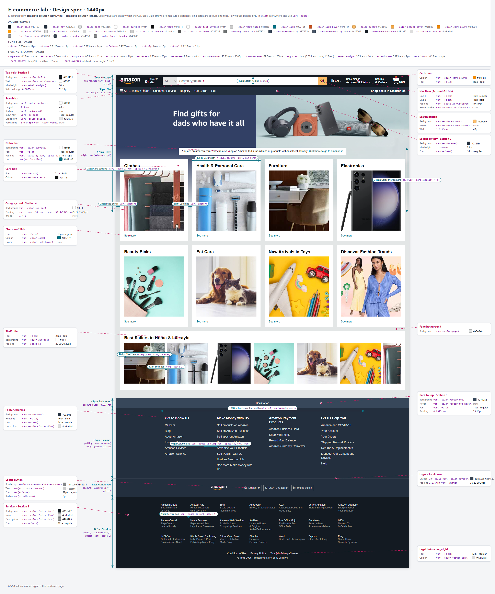

# E-commerce Lab: Design Spec

The values used in the design. Put them in `:root` as design tokens and use
`var(--token)` everywhere else. Token names are suggestions; any clear name is fine.

Sizes are listed in px for reference, with the `rem` value to write in brackets (1rem = 16px).
Where a size should be fluid, the spec says so.

## Final expected look (1440px)

This is how the finished page should look on a 1440px-wide screen.

- **Blue double arrows:** sizes and spacing (heights, widths, gaps, padding) with the token or
  value to use.
- **Pink cards:** the colours and font sizes of each part, with the `var(--token)` for each.
- **Top of the image:** the full list of tokens.

You don't need to match it pixel for pixel. Match the layout, colours, font sizes and spacing,
and make it work on smaller screens too (see `best_practices.md`).



Open [final_expected_look.png](final_expected_look.png) directly to zoom in.

## How to use these values (design tokens)

A **token** is a CSS variable: a name for one design value. You write each value **once**, then
use its name everywhere. Changing the value in one place then updates the whole page, and every
section stays consistent.

**Step 1: define every token once,** inside `:root` at the top of
`style_ecommerce_assignment.css` (under `/* Design tokens */`). Copy the names and values from
the tables below:

```css
:root {
    /* colours */
    --color-belt: #131921;
    --color-accent: #febd69;
    --color-link: #007185;

    /* font sizes */
    --fs-md: 0.875rem;
    --fs-xl: 1.3125rem;

    /* spacing and layout */
    --space-4: 1rem;
    --gutter: clamp(0.625rem, 1.4vw, 1.25rem);
    --content-max: 93.75rem;
}
```

**Step 2: use them in your rules with `var(--name)`,** never the raw value:

```css
.nav-belt {
    background-color: var(--color-belt);   /* not #131921 */
    gap: var(--gutter);
}

.search-submit {
    background-color: var(--color-accent); /* not #febd69 */
}

.card-title {
    font-size: var(--fs-xl);               /* not 21px */
}

.page-content {
    width: min(100%, var(--content-max));  /* not 1500px */
    padding-inline: var(--gutter);
}
```

Rules of thumb:

- **Raw values (`#131921`, `0.875rem`) appear only inside `:root`.** Everywhere else, use `var(...)`.
- **Colours:** every `color`, `background-color` and `border-color` uses a `--color-*` token.
- **Font sizes:** use the `--fs-*` tokens.
- **Spacing:** use the spacing tokens (`--space-1` to `--space-6`) or `--gutter` for `padding`, `margin` and `gap`.
- **Names are up to you,** but keep them clear (`--color-link`, not `--c3`). The names below are suggestions.
- **Colours count for marks.** Colours written as raw hex values outside `:root` lose marks
  (see `best_practices.md`).

## Colours

| Token | Hex | Used for |
|---|---|---|
| `--color-belt` | `#131921` | Section 1 background (top belt) |
| `--color-nav` | `#232f3e` | Section 2 background, Section 5 link-column background |
| `--color-page` | `#e3e6e6` | Page (body) background behind the cards |
| `--color-surface` | `#ffffff` | Cards, notice bar, shelf, search input |
| `--color-text` | `#0f1111` | Main text on light backgrounds |
| `--color-text-inverse` | `#ffffff` | Text on dark backgrounds |
| `--color-text-muted` | `#cccccc` | "Deliver to", locale selector text |
| `--color-link` | `#007185` | Links on light backgrounds ("See more") |
| `--color-link-hover` | `#c7511f` | Link hover |
| `--color-accent` | `#febd69` | Search button |
| `--color-accent-hover` | `#f3a847` | Search button hover |
| `--color-cart-count` | `#f08804` | Cart item count |
| `--color-focus` | `#ff9900` | Focus ring, search bar focus |
| `--color-select` | `#e6e6e6` | Search category dropdown |
| `--color-footer-top` | `#37475a` | "Back to top" bar |
| `--color-footer-top-hover` | `#485769` | "Back to top" hover |
| `--color-footer-deep` | `#131a22` | Section 6 background |
| `--color-footer-link` | `#dddddd` | Footer links, service names |
| `--color-footer-desc` | `#999999` | Service descriptions |
| `--color-divider` | `#3a4553` | Line above the footer logo row |
| `--color-locale-border` | `#848688` | Locale selector border |

## Typography

- Font: `"Amazon Ember", Arial, Helvetica, sans-serif` (Arial is what you will actually see).
- Body text: 14px (`0.875rem`), line-height `1.43`.

| Token | Size | Used for |
|---|---|---|
| `--fs-xs` | 12px (`0.75rem`) | Small nav lines, footer services, legal text |
| `--fs-sm` | 13px (`0.8125rem`) | "See more", notice bar, "Back to top" |
| `--fs-md` | 14px (`0.875rem`) | Nav links, footer links |
| `--fs-base` | 15px (`0.9375rem`) | Search input |
| `--fs-lg` | 16px (`1rem`) | Footer column headings, cart count |
| `--fs-xl` | 21px (`1.3125rem`) | Card and shelf titles (bold) |

## Spacing & layout

| Token | Value |
|---|---|
| `--space-1` ... `--space-6` | 4 / 8 / 12 / 16 / 20 / 40 px (`0.25` / `0.5` / `0.75` / `1` / `1.25` / `2.5rem`) |
| `--content-max` | 1500px (`93.75rem`): maximum width of the card area |
| `--gutter` | fluid, 10-20px: `clamp(0.625rem, 1.4vw, 1.25rem)`, used for page edges and card gaps |
| Radius | 2px (nav hover), 4px (search bar), 3px (locale selectors) |

Breakpoints (use `em`): **64em** (1024px, hide language picker and Returns & Orders),
**48em** (768px, search bar moves to its own full-width row).

## Section by section

### Section 1: Top belt
- Content: Amazon logo (links home), "Deliver to / India", search bar (category dropdown, search
  input, search button), language picker "EN", "Hello, sign in / Account & Lists",
  "Returns / & Orders", Cart with item count.
- Background `--color-belt`. Minimum height 60px (`3.75rem`). Items in a row with a small gap.
- Logo: about 97px wide. The PNG has a lot of transparent padding; crop it with
  `object-fit` / `overflow: hidden`, or accept the extra space.
- Nav items: two text lines, 12px regular over 14px bold. On hover, a 1px white border with no
  layout shift.
- Search bar: **fills all remaining width**, 40px (`2.5rem`) tall, 4px radius. Dropdown
  `--color-select` on the left, input in the middle, search button `--color-accent` 45px wide on
  the right. A 3px `--color-focus` ring when any part of it has focus.
- Cart: cart icon with the count in `--color-cart-count` above it, and "Cart" in bold.

### Section 2: Secondary navigation
- Content: "All" with a hamburger icon; links Today's Deals, Customer Service, Registry,
  Gift Cards, Sell; promo link "Shop deals in Electronics".
- Background `--color-nav`, about 39px tall, 14px white text.
- "All" in bold with a hamburger icon; menu links; "Shop deals in Electronics" in bold pushed to
  the right edge.
- On phones the row scrolls sideways instead of wrapping.

### Section 3: Hero
- Full-width `hero_image.jpg` (3000 x 1200, a 5:2 ratio). Height is fluid:
  `clamp(13rem, 40vw, 37.5rem)`, which is 600px at most.
- Cropped with `object-fit: cover`, keeping the headline (top-left) visible.
- The bottom of the image fades into `--color-page`
  (`mask-image: linear-gradient(to bottom, #000 45%, transparent)`).

### Section 4: Page content
- Limited to `--content-max`, centred, with `--gutter` side padding. It **overlaps the hero**:
  a negative top margin of about 55% of the hero height (about 30% on phones).
- Notice bar: white, 13px, centred, link in `--color-link`. Text: "You are on amazon.com. You can
  also shop on Amazon India for millions of products with fast local delivery. Click here to go
  to amazon.in" (the last sentence links to https://www.amazon.in/).
- 8 category cards using `box1_image.jpg` ... `box8_image.jpg`: Clothes, Health & Personal Care,
  Furniture, Electronics, Beauty Picks, Pet Care, New Arrivals in Toys, Discover Fashion Trends.
  Each has a title, an image and a "See more" link.
- Category cards: white, padding 20px 20px 15px, title 21px bold, square image (`aspect-ratio: 1`,
  `object-fit: cover`), "See more" 13px in `--color-link`. **4 columns on desktop** with a gap
  of `--gutter`, dropping to 2 and then 1 column on smaller screens.
- Best-seller shelf "Best Sellers in Home & Lifestyle": white panel, 8 images, title 21px bold, a row of square images (about 200px)
  that scrolls sideways with scroll snapping.

### Section 5: Footer nav
- "Back to top": full width, `--color-footer-top`, 13px, centred, 15px vertical padding.
- 4 link columns:
  - **Get to Know Us:** Careers, Blog, About Amazon, Investor Relations, Amazon Devices, Amazon Science
  - **Make Money with Us:** Sell products on Amazon, Sell on Amazon Business, Sell apps on Amazon,
    Become an Affiliate, Advertise Your Products, Self-Publish with Us, Host an Amazon Hub,
    See More Make Money with Us
  - **Amazon Payment Products:** Amazon Business Card, Shop with Points, Reload Your Balance,
    Amazon Currency Converter
  - **Let Us Help You:** Amazon and COVID-19, Your Account, Your Orders, Shipping Rates & Policies,
    Returns & Replacements, Manage Your Content and Devices, Help
- The columns sit on `--color-nav`, centred in a 1000px (`62.5rem`) wide area. Headings 16px bold
  white; links 14px `--color-footer-link`. Columns wrap on small screens.
- A 1px `--color-divider` line, then a centred row: logo (about 76px), and three selectors
  (English, USD - U.S. Dollar, United States) with a 1px `--color-locale-border` border,
  3px radius, 12px `--color-text-muted` text.

### Section 6: Services & legal
- Background `--color-footer-deep`.
- Services grid inside the same 1000px area: columns about 120px or wider, 12px text.
  Name in `--color-footer-link`, description in `--color-footer-desc`.
- 21 services (name / description):
  Amazon Music / Stream millions of songs · Amazon Ads / Reach customers wherever they spend
  their time · 6pm / Score deals on fashion brands · AbeBooks / Books, art & collectibles ·
  ACX / Audiobook Publishing Made Easy · Sell on Amazon / Start a Selling Account ·
  Amazon Business / Everything For Your Business · AmazonGlobal / Ship Orders Internationally ·
  Home Services / Experienced Pros Happiness Guarantee · Amazon Web Services / Scalable Cloud
  Computing Services · Audible / Listen to Books & Original Audio Performances · Box Office Mojo /
  Find Movie Box Office Data · Goodreads / Book reviews & recommendations · IMDb / Movies, TV &
  Celebrities · IMDbPro / Get Info Entertainment Professionals Need · Kindle Direct Publishing /
  Indie Digital & Print Publishing Made Easy · Prime Video Direct / Video Distribution Made Easy ·
  Shopbop / Designer Fashion Brands · Woot! / Deals and Shenanigans · Zappos / Shoes & Clothing ·
  Ring / Smart Home Security Systems
- Legal links (12px, centred, in a row): Conditions of Use, Privacy Notice, Your Ads Privacy
  Choices. Below them, the copyright line: "© 1996-2026, Amazon.com, Inc. or its affiliates".

## Assets

`amazon_logo.png` (1920 x 1080, white logo on transparent background), `hero_image.jpg`
(3000 x 1200), `box1_image.jpg` to `box8_image.jpg` (box1 and box3: 372 x 232; box4: 392 x 400;
the rest: 758 x 608). Icons: Font Awesome 6 (already linked in the template), or inline SVG.
